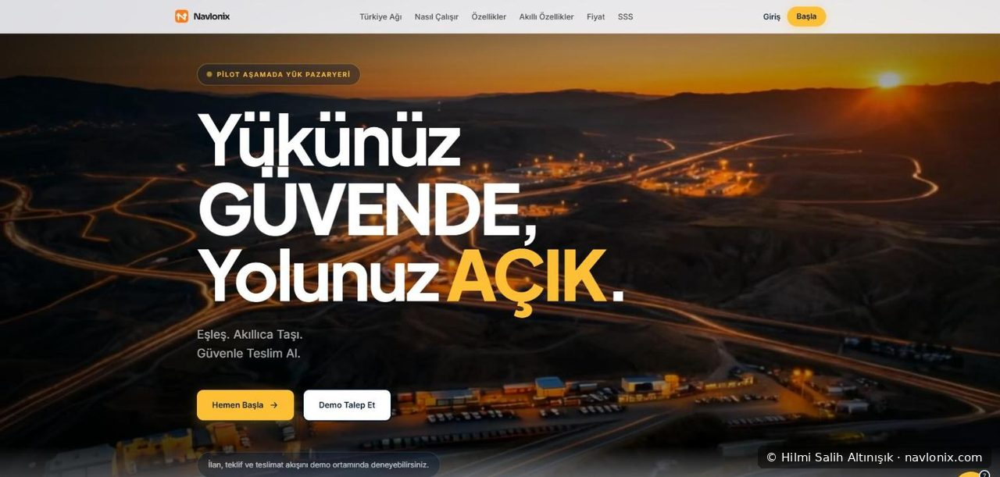
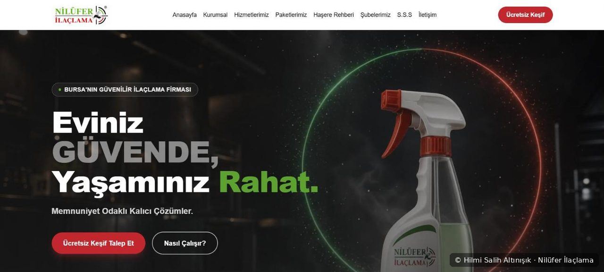

### Hilmi Salih Altınışık

Software engineer based in Türkiye. I build software that real businesses run on every day: freight, field service, point of sale, stock and finance. Most of it is private client and product work, so this page shows what the products do rather than how they are built.

 

#### Navlonix — freight marketplace

Businesses that need to move cargo post a load; verified drivers send offers; the job is tracked until delivery is confirmed. It replaces the phone calls, haggling and cash risk that most domestic freight still runs on. Web, mobile and an admin panel, in pilot stage.

[navlonix.com](https://navlonix.com)

 

#### Nilüfer İlaçlama — field-service operations

A pest-control company in Bursa runs its customers, field crews, contracts and payments from one system instead of spreadsheets and phone calls. Public website, office panel and a mobile app for staff in the field.

 

#### Other work

| | |
| --- | --- |
| **Tatlı Durağı** | QR ordering and point of sale for a dessert shop. Delivered and in daily use. |
| **Finans Pro** | Personal finance: income, expenses, budgets and gold / currency holdings. |
| **Nalbur Stok** | Stock management for hardware stores with very large product lists. |
| **Instagram AI Manager** | Inbox, comments and publishing for business accounts, with a human approving every action. |

I also contribute to partner products (label printing, a couples app, invitation design) built with [Talha Mercan](https://github.com/talhamercan).

 

#### In numbers

1,342 commits in the last 12 months across 26 repositories. Mostly TypeScript, C#, Python and Dart.

 

#### Contact

[LinkedIn](https://www.linkedin.com/in/hilmi-salih-alt%C4%B1n%C4%B1%C5%9F%C4%B1k-6a9301294/) · [altinisikhilmisalih@gmail.com](mailto:altinisikhilmisalih@gmail.com)

Source code for these products is private. Screenshots and descriptions on this page are © Hilmi Salih Altınışık and may not be reused without permission.
